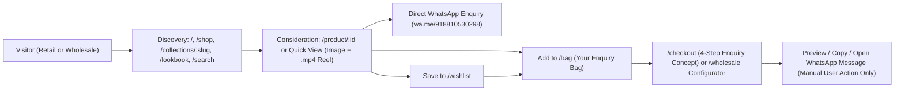

# Commerce Journey & UX Boundaries Blueprint (`Prompt 007`)

## 1. Dual-Journey Architecture

Because **ANIL CLOTH HOUSE** positions itself as both a **Manufacturer and Wholesaler** (`info/profile.json`) and an **Export and Manufacturing ethnic wear store** (`info/posts.json`) with **NO COD** and WhatsApp ordering (`+91 8810530298`), the storefront serves two complementary buyer journeys without a backend or live payment gateway:

### Journey A: Individual & Occasion Shoppers (`Explore Collection`)
1. **Entry**: Editorial Homepage (`/`), Shop All (`/shop`), Curated Collections (`/collections/:slug`), Lookbook (`/lookbook`), or Instant Search (`/search?q=`).
2. **Consideration**: Product Detail Page (`/product/:id`) or Quick View modal with full `640×1136` portrait imagery, playable local Instagram Reel `.mp4` video, honest specification table, and source Instagram post provenance link.
3. **Shortlist & Consolidation**:
   - Save favorites to **Wishlist** (`/wishlist`).
   - Add 1–10 designs to **Your Enquiry Bag** (`/bag`) with Personal intent and notes.
4. **Conversion Handoff**:
   - **Direct**: Click **Ask About This Design on WhatsApp** on PDP/Quick View to open `https://wa.me/918810530298?text=...` with prefilled design reference `ACH-<shortcode>` and source URL.
   - **Consolidated**: Proceed through `/bag` or `/checkout` (`Order Enquiry / Checkout Concept`) to review items, specify delivery city/country, acknowledge the `NO COD` policy, and generate a formatted multi-design WhatsApp message.

### Journey B: Boutique & Bulk Buyers (`Wholesale Enquiry`)
1. **Entry**: Dedicated B2B destination (`/wholesale`), header Wholesale CTA, or homepage mid-page Wholesale feature.
2. **Selection**: Browse the Wholesale-ready catalog grid on `/wholesale` (or `/shop` with Wholesale intent active), adding designs to the Enquiry Bag with desired unit quantities of interest.
3. **Configuration**: Use the **Wholesale Bulk Inquiry Configurator** on `/wholesale` (or `/checkout` in Wholesale mode) to enter optional business/boutique name, buyer type (Retail Boutique, Reseller, International Buyer), city/country, selected design IDs, and approximate piece count.
4. **Conversion Handoff**: Preview, copy, or open the structured trade enquiry in WhatsApp (`+91 8810530298`).

## 2. Route Sitemap

| Route | Screen Title | Purpose |
| :--- | :--- | :--- |
| `/` | Home — Editorial Storefront | Hero carousel, confidence strip, category tiles, 8-item rail, wholesale intro, embroidery story, lookbook & Instagram origin |
| `/shop` | Shop All — Catalog & Archive | Filterable/sortable grid of 36 curated designs + switch for all 97 media-backed archive designs |
| `/collections/:slug` | Editorial Collection | Tailored masthead & prefiltered product grid (`embroidered-edit`, `festive-selections`, `statement-details`, `draped-silhouettes`) |
| `/product/:id` | Product Detail (PDP) | Portrait image + local `.mp4` Reel video gallery, honest specs, WhatsApp CTA, Enquiry Bag, How Ordering Works, Provenance, Related Designs |
| `/lookbook` | Editorial Lookbook & Reels | Visual masonry & playable Reel gallery with modal zoom/video viewer and direct design links |
| `/search` | Search Results (`?q=`) | Query matching across shortcode, `ACH-` display ID, title, color tags, and captions with search tips |
| `/wishlist` | Saved Shortlist | LocalStorage-backed wishlist with quick move-to-enquiry-bag and clear-all confirmation |
| `/bag` | Your Enquiry Bag | Multi-design enquiry builder with Personal vs. Wholesale toggle, unit quantity stepper, per-item notes, and WhatsApp composer |
| `/checkout` | Order Enquiry / Checkout Concept | 4-step front-end prototype (1. Contact, 2. Delivery & NO-COD Transparency, 3. Review Enquiry, 4. Ready-to-Send Confirmation) |
| `/wholesale` | Wholesale & Trade Enquiries | B2B landing page, trade browsing bridge, and Bulk Inquiry Configurator |
| `/our-story` | Our Story & Positioning | Sourced brand story (Manufacturer & Wholesaler in NIT Faridabad), store provenance, and pending owner confirmations |
| `/contact` | Contact & Showroom Info | Verified WhatsApp, Instagram, NIT Faridabad address variants, and interactive enquiry composer |
| `/faq` | Frequently Asked Questions | Source-aware accordion grouped into Ordering, Prices, Wholesale, Shipping, and Returns |
| `/shipping` | Provisional Shipping Information | Distinguishes stated `Worldwide shipping` bio claim from unconfirmed rates/timelines |
| `/returns` | Provisional Returns & Exchanges | Transparent notice that return/exchange terms must be confirmed with the store before payment |
| `/demo-notice` | Unofficial Private Concept Notice | Full disclosure of frontend-only behavior, data provenance, local browser storage, and `Clear Demo Data` utility |
| `/design-system` | Internal Design System Showcase | Live token preview, typography hierarchy, buttons, inputs, cards, and accessibility states (excluded from main nav) |
| `*` | 404 — Page Not Found | Helpful recovery screen with search and collection links |

## 3. Interaction Diagram

## 4. Trust & Compliance Boundaries
- **No Fake Checkout**: Never shows credit card inputs, UPI QR codes, Razorpay/Stripe widgets, fake order numbers, or "Order Confirmed" messages.
- **No Silent Network Calls**: No form submission leaves the browser; WhatsApp opens only upon explicit user click.
- **Noindex Protection**: Every route sets `noindex, nofollow` and displays the `Unofficial Private Concept Demo` disclosure.

